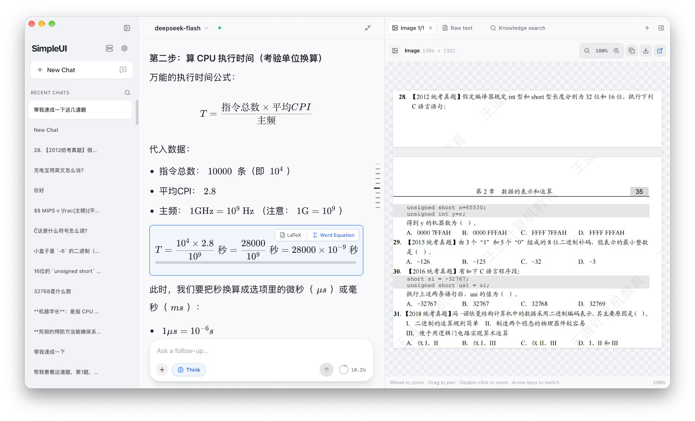

# SimpleUI

<p align="center">
  <a href="README.md"><b>简体中文</b></a> · <a href="README_EN.md">English</a>
</p>

<p align="center">
  <strong>本地优先的 macOS AI 工作台</strong><br>
  多模型集成 · 离线维基 RAG · 实时双语字幕 · 原生悬浮窗
</p>

<p align="center">
  React 19 · TypeScript · Vite · Tailwind CSS · KaTeX · Pyodide · Swift / WebKit · Apple Silicon
</p>

SimpleUI 为 [TurboFieldfare](https://github.com/drumih/turbo-fieldfare) 深度适配，支持 [Mference](https://github.com/NeelM0906/Mference) 与 [DeepSeek 官方 API](https://api-docs.deepseek.com/)，并通过 OpenAI 兼容接口连接 Ollama、vLLM、llama.cpp server、LM Studio 等推理服务。

---

## 界面预览

<p align="center">
  
</p>

<p align="center">
  <sub>中文主界面 · <a href="docs/assets/main-en.png">English UI</a></sub>
</p>

---

## 核心亮点

- **本地优先**：模型推理、知识库、语音识别、语音合成、OCR 识图、字幕和翻译都在本机完成；无需自行安装或配置 Python 环境、向量数据库或云端 API。
- **模型集成服务**：统一托管基础模型、SenseVoice 语音输入、Qwen3-TTS 语音合成、PaddleOCR-VL 视觉文档识别、R2T2 流式字幕、Index-Translate 翻译与 CoreML 断句模型。
- **视觉图文识别（OCR 提取 Markdown）**：快捷键 `⌘⇧2` 框选屏幕任意区域，由端侧多模态模型 PaddleOCR-VL 自动提取结构化 Markdown（段落、表格、LaTeX 公式、图表）存入剪贴板；纯按需运行，闲置超时自动释放显存。
- **DeepSeek API 深度适配**：官方 Base URL / API Key / 模型 / 上下文 / 温度 / top_p / 推理强度 / 停止串 / 系统提示词独立配置，直接请求官方接口，并针对缓存命中做上下文修剪。
- **离线维基 RAG**：Kiwix ZIM + 多通道检索 + 原文直注；不摘要、不改写、不机械截断，答案带可点击引用。
- **浏览器式多标签侧栏**：右侧集成统一的多标签页抽屉（离线维基检索 / 百科条目 / 回答源码 / 原生大图预览），支持多标签并发切换、拖拽分栏与实时尺寸 HUD，Spotlight 浮窗具备同款轻量单页层。
- **长对话虚拟化与刻度定位**：采用基于几何测量的虚拟窗口化渲染（20 轮内原生全量挂载，长会话动态预算挂载），彻底消除长对话卡顿掉帧；右侧配备轮次定位轨（Turn Rail），支持悬停预览与一键直达跳转。
- **实时双语字幕**：SOTA SaT 断句、R2T2 流式识别、Index-Translate 整句翻译，原文实时、译文按句追加。
- **强大前端与科学计算**：Markdown / KaTeX / Mermaid，代码块支持一键收起与复制代码；内置 **Pyodide Python 科学计算沙盒**，免配置环境在浏览器沙盒内一键运行代码，源码与运行结果双层独立折叠；公式块可复制为 Word / WPS 原生公式，表格可保留格式粘贴到 Word。
- **原生 macOS**：主窗口 + Spotlight 浮窗 + 快捷翻译 + 字幕悬浮窗 + 全屏截图 OCR，支持中英文界面与深浅色主题。

---

## 系统架构

```text
React 前端 / Swift 原生窗口
        │
        ▼
Node.js 代理（127.0.0.1:31235）
        │
        ├── 基础模型服务（TTF :1235 / Mference :1241 / OpenAI 兼容）
        ├── DeepSeek 官方 API（云端）
        ├── 离线维基 RAG（Kiwix :31236 + 本地 ZIM）
        ├── 语音输入（SenseVoice · audio.cpp :1236）
        ├── 语音合成（Qwen3-TTS 1.7B · MLX :1255）
        ├── 视觉文档识别（PaddleOCR-VL 1.6 · MLX :1252）
        ├── 实时双语字幕
        │     ├── R2T2 Q8_0 流式识别（:1250 · Metal）
        │     ├── SaT-3L-sm CoreML 断句（ANE / CPU）
        │     ├── Index-Translate-2B Q4_K_M（:1249 · Metal）
        └── 快捷翻译（独立原生悬浮窗）
```

| 服务 | 默认端口 | 职责 |
| :--- | :--- | :--- |
| Node 代理 `proxy.js` | `31235` | 静态托管、SSE 透传、动态路由、受管服务 API |
| Kiwix 离线百科 | `31236` | 本地 ZIM 条目、标题联想、全文检索 |
| SenseVoice 语音输入 | `1236` | 长按右 ⌘ 的本地中英语音转文字 |
| Qwen3-TTS 语音合成 | `1255` | 回复朗读时的端侧语音合成（逐段合成后拼接落盘，每次生成现场加载） |
| PaddleOCR-VL 视觉识别 | `1252` | `⌘⇧2` 框选屏幕提取 Markdown 到剪贴板（纯按需，闲置超时自动卸载） |
| R2T2 字幕识别 | `1250` | 追加式流式识别，原生标点 |
| Index-Translate 字幕翻译 | `1249` | 专精神经机器翻译 |
| 基础模型 | `1235` / `1241` | TTF / Mference / 兼容 OpenAI 的推理服务 |
| DeepSeek API | 云端 | 官方 API：对话、推理与快捷翻译 |

> 基础模型本体与权重不随本仓库分发，需要用户自行准备；语音输入模型随包内置，TTS、OCR 与字幕模型可在应用内「服务管理」按需自动测速下载。

---

## 离线维基 RAG

SimpleUI 使用本地 Kiwix ZIM 构建端到端离线知识库。核心原则是：

> **注入给模型的正文是原文，不是模型摘要；不重写、不截断。**

```text
提问
  → OpenCC 简繁/港台词汇归一
  → 主力模型规划 1~2 个条目名
  → 多通道召回（精确探针 / 标题联想 / 消歧义页 / 全文检索）
  → 命名空间过滤 + 规范路径去重
  → 抓取条目 HTML，DOM 解析
  → 原文直注（Infobox / 引言 / 段落 / 列表 / 表格 / 公式）
  → 生成答案 + 引用胶囊
```

- 条目名由主力模型规划，检索结果按可靠度收敛；不是把整篇维基硬塞进上下文。
- 长条目只做“目录路由”，保留完整引言，不机械截断正文。
- 公式以 LaTeX 保留，表格以管道表/结构化数据保留，图片与图注在右侧多标签面板中还原。
- 采用**浏览器式多标签面板**：支持离线检索、百科条目、引用原文及原图的多标签并发浏览与回溯，无缝支持新开标签、拖拽分栏与双击复位。
- 需要本地 ZIM 文件；运行时已随包分发，路径可在「服务管理 → 知识库」中配置。

### 中文检索为什么准

1. **中文优先归一**：先用 OpenCC 做简繁与港台词汇归一，再扩展字形变体，避免中文 ZIM 因“鼠標/鼠标/滑鼠”等写法差异漏检。
2. **模型规划 + 多通道召回**：主力模型只负责规划 1~2 个规范条目名；精确探针、标题联想、消歧义页、全文检索按可靠度收敛，全文检索只在必要时启用。
3. **消歧义交给模型**：精确命中消歧义页时，由主力模型从义项列表中选一个；不靠硬编码实体类型打分。
4. **原文直注**：DOM 解析后注入 Infobox、完整引言、段落、列表、表格与 LaTeX 公式；不做模型摘要、不机械截断，答案可直接引用原文。
5. **引用可回看**：答案中的引用胶囊只指向条目名，点击可在右侧面板以独立标签页打开并高亮对应原文小节，核对更高效。

---

## 模型集成服务

### 基础模型与 DeepSeek API

- 本地深度适配 **TurboFieldfare**（默认端口 `1235`），同时支持 **Mference**（默认端口 `1241`）。
- **DeepSeek 官方 API 是一等 Provider**：独立配置 Base URL、API Key、模型、上下文窗口、温度、top_p、推理强度、停止串与系统提示词；请求直接发往 `api.deepseek.com`，不经过本地推理进程。
- DeepSeek 模式针对官方缓存行为做上下文修剪（批量修剪到 70% 水位），减少缓存失效与重复 prefill。
- 通过 OpenAI 兼容接口连接 Ollama、vLLM、llama.cpp server、LM Studio 等。
- 服务管理面板提供启停、状态、参数调优、日志与模型目录浏览；切换本地基础引擎时执行显存互斥释放。
- 本地上游项目与模型权重需自行准备，详见 [TurboFieldfare](https://github.com/drumih/turbo-fieldfare) / [Mference](https://github.com/NeelM0906/Mference)；DeepSeek 只需在设置中填写 API Key。
- 说明：DeepSeek 模式会自动关闭知识库入口；离线维基 RAG 面向本地模型链路。

### 全局语音输入

- 模型：SenseVoice-Small Q8_0（audio.cpp），随包内置运行时与模型。
- 操作：长按右侧 `⌘` 说话，松开后转写并写入当前输入框；在其它 App 中通过剪贴板粘贴。
- 支持中英语音、内置 Silero VAD，断网可用。
- 首次使用需授予麦克风、辅助功能、输入监控权限。

### 离线实时双语字幕

SimpleUI 的实时字幕完全在 Apple Silicon 本地运行：**音频不上传，不调用云端 API**，ASR、断句和翻译均由本地模型完成。适用于看剧、会议、演讲、播客等场景。

```text
系统音频（16kHz mono PCM）
  → R2T2 Q8_0 流式识别（audio.cpp · Metal）
  → SaT-3L-sm 断句（CoreML · ANE）
  → Index-Translate-2B 整句翻译（llama.cpp · Metal）
  → 原文实时流 / 译文按句追加
```

| 组件 | 模型 / 版本 | 体积 | 运行位置 |
| :--- | :--- | ---: | :--- |
| 流式识别 | Confucius4-R2T2 Q8_0 | 2.31 GiB | audiocpp · Metal（`:1250`） |
| 智能断句 | [SaT-3L-sm](https://huggingface.co/segment-any-text/sat-3l-sm) CoreML FP16 | 240 MB | CoreML · ANE / CPU |
| 整句翻译 | [Index-Translate-2B](https://huggingface.co/IndexTeam/Index-Translate-2B-GGUF) Q4_K_M | 1.22 GiB | llama-server · Metal（`:1249`） |
| 断句分词 | XLM-R `tokenizer.json` | 9 MB | Node |

> 字幕模型遵循各自上游许可证；SaT 权重为 MIT，其 CoreML 转换包请自行确认分发授权。
>
> R2T2 只接受 **audio.cpp 打包格式**的 GGUF（当前随下载提供 `Q8_0`，2.31 GiB）。官方
> [netease-youdao/Confucius4-R2T2-GGUF](https://huggingface.co/netease-youdao/Confucius4-R2T2-GGUF)
> 是 llama.cpp 布局（`blk.*` + 独立 `mmproj`），audio.cpp 无法加载，因此其中的 `Q4_K_M` 等低比特档位暂不可用。

工作方式：

- **音频全量直连 R2T2**：不使用能量 VAD、不裁剪静音、不丢帧。
- **完整句翻译**：SaT 按完整句切分，翻译只处理完整句；只有收尾时的尾部半句才会单独翻译。
- **会话轮转**：断出 2 句立即轮转；只有 1 句但 live 流已满 5.2 秒也轮转；9.6 秒为硬上限，防止单条流无限累积导致 GPU 重算开销爆炸。
- **静音收尾**：连续静音超过 1.8 秒且已有识别文本时收尾，此时才把尾部半句作为完整句提交。
- **稳定吐出尾部**：关闭请求前补 360ms 静音，确保 R2T2 返回最后未提交的文本。
- **语言方向**：支持英文→中文/日文、中文→英文/日文；声音源与目标语言在字幕悬浮窗切换。
- **严格按需**：打开字幕窗口才加载，关闭即卸载；失败直接 fatal，不自动重启/重连。
- **模型目录**：`~/Library/Application Support/SimpleUI/models/subtitles_pipeline/`；服务管理面板支持三模型测速下载与断点续传。

### 划选浮标（翻译 / 朗读）

- 在任意消息正文中划选文本，选区旁会出现「**翻译**」与「**朗读**」两个圆角按钮：翻译会直接呼出快捷翻译窗口，把选区的纯文本填入，并以快速模式自动翻译；朗读走 macOS 系统语音，再点一次或按 `Esc` 停止。
- 划选浮标由主窗口与 Spotlight 浮窗共用同一套实现，两个窗口行为完全一致；纯浏览器调试（无原生桥）时自动隐藏「翻译」按钮。
- 每条回答下方也有一个朗读按钮（在「重试」左侧）：点击后按**视觉段落**切开（标题、列表、表格各自成段，段落内的软换行先拼回一行），逐段交给模型合成；代码块与公式（`$…$` / `$$…$$` / `\[…\]`）整段跳过、一个字符都不送进去，emoji 与键帽符号一律剔除，表格按行读取、单元格用「，」连接。消息下方先出现分段进度条，全部完成后变成播放器（播放 / 暂停、进度拖动、静音、重新生成与删除音频）。
- 模型：Qwen3-TTS 1.7B CustomVoice（MLX 6bit，约 2.5 GB，含独立语音 codec），默认音色 `serena`。
- 公式块带 `select-none`，划选时会自然跳过；代码块按原文朗读，不解释语法。
- 每次生成现场加载模型、生成结束后立即卸载，**不保留常驻进程，也没有闲置计时**；模型载入约 15 秒（权重已在页缓存时更快），进度条会显示「正在加载语音模型」。
- 合成完成的音频会拼成一条 WAV 落盘到 `~/Library/Application Support/SimpleUI/tts_output/`，重启应用后播放条按内容指纹自动恢复；接口 `POST /api/tts/article`（NDJSON 进度流）。
- 「服务管理 → 语音合成服务」：面板展示内置 Python 运行环境与模型就绪状态，支持音色切换、采样参数（`temperature` 0.85 / `top_p` 0.95 / `top_k` 50 / `repetition_penalty` 1.05 / `max_tokens` 1024，均可调）、双源自动测速下载与恢复默认配置。
- 该功能的推理走随包分发的 mlx-audio（Python）运行时，主对话链路仍不依赖 Python。

### 截屏图文识别（OCR 提取 Markdown）

- 全局快捷键 `⌘⇧2`（或通过状态栏菜单触发），调起原生全屏十字框选截屏工具。
- 模型：PaddleOCR-VL 1.6（MLX 8-bit 量化，约 1.09 GB），纯端侧运行，图像与文本数据不离开本机。
- 结构化提取：针对复杂版面深度优化，自动提取正文段落、层级标题、Markdown 复杂表格、LaTeX 行内/行间数学公式（`$...$` / `$$...$$`）与图表文本，识别完成后自动存入系统剪贴板并弹出完成通知。
- 纯按需运行：首次截图触发时拉起 Python MLX-VLM 后端（冷启动预热约 2~5 秒），**闲置超时自动卸载**（默认 30 分钟，可自由指定）并退出进程，彻底释放统一内存与显存；对应接口 `POST /api/ocr/recognize`。
- 服务管理面板：支持切换识别任务模式（通用文档 / 表格提取 / 公式识别 / 图表解析）、调节图像分辨率预算（均衡 / 高 / 最高）、自定义闲置超时，并提供官方源与国内镜像源自动并发测速下载与断点续传。

### 快捷翻译

- 全局快捷键 `⌃ Control + Space`，原生非激活浮窗，不抢当前应用焦点。
- 支持自动、中→英、英→中、详解四种模式，`Enter` 翻译、`⌘C` 复制、双向 TTS。
- 详解模式的结果区默认不可朗读：先在结果中划选文字，朗读按钮才会启用，并且只朗读选中的内容；快速模式仍是一键朗读整段结果。按钮不可用时会显示中英文提示，鼠标保持普通箭头。单击结果框内会取消选中，关闭再打开也会清空选区。
- 结果区支持基础 Markdown 排版：标题、列表、引用、代码块、分割线，以及粗体、斜体、行内代码、删除线和链接；表格和多级标题按普通文本显示。
- 结果区使用原生可选文本视图，支持 `⌘C`、`⌘A` 和右键复制，并带有轻量圆角容器与强调色选中边框。
- Provider 可选 TTF、Mference、OpenAI 兼容服务或 DeepSeek；独立提示词，默认关闭思考。
- 服务端未连接时自动重连 3 次后给出中英文错误提示；不再使用 3 秒硬超时，详解等较长结果可以正常返回。

---

## 前端

- **轻量**：React 19 + TypeScript + Vite + Tailwind；原生 Swift/WebKit 外壳，无重型前端框架依赖。
- **浏览器式多标签侧栏**：内置统一的多标签页面板，支持离线知识库检索、百科条目阅读、Markdown 源码核对与高清图片查看；支持拖拽调整分栏宽度（附实时尺寸 HUD 与最小宽度保护），主窗口与 Spotlight 浮窗体验高度统一。
- **长对话虚拟化与定位轨**：测量式虚拟窗口化加载（按轮次预估与实测占位高度，短会话全量原生挂载，长会话动态预算挂载），彻底消除长对话卡顿掉帧；配备右侧轮次刻度轨（Turn Rail），支持悬停预览、点击直达与拖动导航。
- **高清图片查看器**：多图画廊导航、滚轮与双击平滑缩放、拖拽平移、原图尺寸统计，支持一键复制图片、本地保存以及直接唤起 macOS 系统预览（Preview.app）。
- **生命周期保护**：用户发送的图片采用内容寻址（SHA-256）落盘，生命周期严格绑定至消息轮次与会话删除，历史长会话切换自动平滑定位至最后一条消息。
- **富文本渲染**：Markdown、KaTeX 公式、Mermaid 图、表格、代码块、图片缩放预览、思考折叠。
- **内置 Python 科学计算沙盒**：
  - **免本地环境**：基于 WebAssembly 技术的 Pyodide 解释器在独立的 Web Worker 中全离线沙盒运行，随前端资源随包打包，无需本机安装 Python、pip 或任何虚拟环境。
  - **一键即时运行**：Python 代码块顶栏集成「运行」按钮，支持标准输出（`stdout`）、末尾表达式结果（`Out:`）与运行时异常完整追踪（Traceback）。
  - **双层独立折叠交互**：代码层与执行结果层各自拥有独立的折叠/展开控件，互不干扰；点击「运行」或「重新运行」时保留代码块现有的折叠状态，避免长代码自动弹开破坏阅读视野。
- **长代码折叠优化**：所有代码块顶栏最右侧均配备收起按钮，支持用户手动折叠长代码块。
- **复制能力（Word 兼容）**：

| 内容 | 复制行为 |
| :--- | :--- |
| 公式块 | 复制为 Word / WPS 原生 OMML 或标准 MathML，粘贴后是可编辑公式 |
| 表格 | 复制为带样式的 DOCX 表格 XML / 富文本，保留表头、边框、合并单元格 |
| 代码块 | 右上角按钮一键复制纯代码；选中代码时只复制选中行 |
| 普通文本 | 复制为干净的 Markdown 原文 |

公式与表格的 Word 兼容序列化位于 `src/utils/selectionToMarkdown.ts`；代码块复制与运行沙盒由 `MarkdownRenderer` 的代码块组件提供。

- **原生体验**：主窗口、Spotlight 浮窗、快捷翻译、字幕悬浮窗、语音胶囊；全局快捷键与深浅色主题。
- **双语界面**：中英文文案同步，字幕/服务面板/错误提示均支持中英文。
- **上下文可视化**：实时上下文圆环、阶段阶梯、性能页脚与跨窗口流同步。

---

## 快速开始

### 前提

- Node.js ≥ 18
- macOS 15+（构建原生 App）
- 可选：本地基础模型服务（TTF / Mference / Ollama / vLLM / llama.cpp / LM Studio）
- 可选：DeepSeek API Key（云端对话/翻译）
- 可选：本地 Kiwix ZIM 文件（离线维基）

### 一键启动

```bash
./start.sh
```

首次运行会安装依赖；若 `dist/` 不存在会先构建，然后启动代理并打开 `http://127.0.0.1:31235`。

### 开发模式

```bash
./start.sh dev
# 或
npm run dev
```

### 构建 macOS App

```bash
./build_mac_app.sh install
```

构建 Swift 原生外壳、前端产物与内置运行时，安装到 `/Applications/SimpleUI.app`。修改前端后需要重新执行构建，已安装 App 使用包内副本。

### 模型与知识库

- 基础模型：自行准备 TTF / Mference 本体与权重；也可连接其它 OpenAI 兼容服务，或在设置中直接配置 DeepSeek API Key。
- 语音输入模型：SenseVoice Q8_0 随包内置（不提供在线下载；若缺失，需手动放入 `~/Library/Application Support/SimpleUI/models/`）。
- 语音合成模型：在「服务管理 → 语音合成服务」一键测速下载 Qwen3-TTS 1.7B 模型（约 2.5 GB；语音 codec 与旧版字节相同，会被完整性校验直接复用）。
- 视觉 OCR 模型：在「服务管理 → 视觉图文识别服务」一键测速下载 PaddleOCR-VL 1.6 模型（约 1.09 GB）。
- 字幕模型：在「服务管理 → 实时字幕服务」下载，包含 R2T2、SaT、Index-Translate 与 tokenizer。
- 离线维基：在「服务管理 → 知识库」中指定本地 ZIM 文件。

---

## 项目结构

```text
SimpleUI/
├── src/                  React 前端（聊天、Markdown/KaTeX、知识库、字幕、OCR、设置）
├── server/               Node 代理与受管服务
│   ├── proxy.js          HTTP/SSE 入口（:31235）
│   ├── ocr_service.js    PaddleOCR-VL 托管服务
│   ├── tts_service.js    Qwen3-TTS 托管服务
│   ├── subtitle_service.js 实时字幕流水线服务
│   ├── asr_service.js    SenseVoice 原生语音输入服务
│   ├── wiki_service.js   Kiwix 离线维基服务
│   ├── ocr/              Python MLX-VLM OCR 推理服务
│   ├── tts/              Python MLX-Audio TTS 推理服务
│   └── subtitles/        字幕 helper / 断句 / 翻译模块
├── mac_app/              Swift 原生应用（主窗口、Spotlight、快捷翻译、字幕悬浮窗、框选截图、系统热键）
├── bin/                  Kiwix / audio.cpp / llama.cpp / 字幕 helper
├── scripts/              构建、同步与测试脚本
└── build_mac_app.sh      macOS App 构建与安装
```

---

## 开源协议

本项目基于 [Apache License 2.0](LICENSE) 开源。
