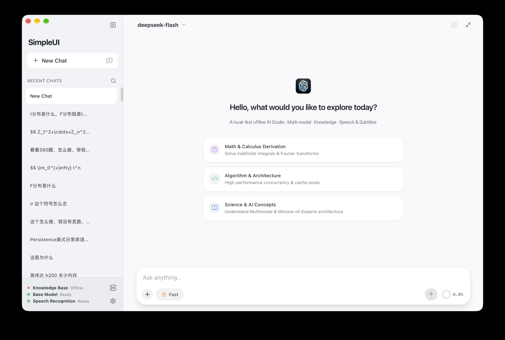

# SimpleUI

<p align="center">
  <a href="README.md">简体中文</a> · <a href="README_EN.md"><b>English</b></a>
</p>

<p align="center">
  <strong>A local-first AI workspace for macOS</strong><br>
  Multi-model integration · Offline Wiki RAG · Real-time bilingual subtitles · Native floating panels
</p>

<p align="center">
  React 19 · TypeScript · Vite · Tailwind CSS · KaTeX · Pyodide · Swift / WebKit · Apple Silicon
</p>

SimpleUI is deeply tuned for [TurboFieldfare](https://github.com/drumih/turbo-fieldfare), supports [Mference](https://github.com/NeelM0906/Mference) and the [DeepSeek official API](https://api-docs.deepseek.com/), and connects to Ollama, vLLM, llama.cpp server, LM Studio, and other services through OpenAI-compatible APIs.

---

## Screenshots

<p align="center">
  
</p>

<p align="center">
  <sub>English UI · <a href="docs/assets/main-cn.png">中文界面</a></sub>
</p>

---

## Highlights

- **Local-first**: inference, knowledge retrieval, speech recognition, subtitles, and translation all run on-device — no need to install or configure Python yourself, no vector database, and no cloud API.
- **Model integration services**: unified management for base models, SenseVoice speech input, R2T2 streaming captions, Index-Translate, and CoreML segmentation models.
- **DeepSeek API integration**: independent Base URL / API key / model / context / temperature / top_p / reasoning effort / stop strings / system prompt; requests go directly to the official endpoint, with cache-friendly context trimming.
- **Offline Wiki RAG**: Kiwix ZIM + multi-channel retrieval + direct raw-text injection; no summarization, no rewriting, no mechanical truncation, with clickable citations.
- **Real-time bilingual subtitles**: SOTA SaT sentence segmentation, R2T2 streaming ASR, and Index-Translate sentence translation; source text streams live while translations are appended per sentence.
- **Strong frontend & scientific computing**: Markdown / KaTeX / Mermaid, one-click code-block collapse/copy; built-in **Pyodide Python scientific computing sandbox** running client-side with zero local environment setup, two independent collapsible layers for source and execution output; formulas copyable as native Word/WPS equations, and tables retain formatting when pasted into Word.
- **Native macOS**: main window, Spotlight panel, quick translate, subtitle overlay, and voice capsule; Chinese/English UI with light/dark themes.

---

## Architecture

```text
React frontend / Swift native windows
        │
        ▼
Node.js proxy (127.0.0.1:31235)
        │
        ├── Base model service (TTF :1235 / Mference :1241 / OpenAI-compatible)
        ├── DeepSeek official API (cloud)
        ├── Offline Wiki RAG (Kiwix :31236 + local ZIM)
        ├── Speech input (SenseVoice · audio.cpp :1236)
        ├── Real-time bilingual subtitles
        │     ├── R2T2 Q8_0 streaming ASR (:1250 · Metal)
        │     ├── SaT-3L-sm CoreML segmentation (ANE / CPU)
        │     ├── Index-Translate-2B Q4_K_M (:1249 · Metal)
        └── Quick Translate (separate native floating panel)
```

| Service | Default port | Role |
| :--- | :--- | :--- |
| Node proxy `proxy.js` | `31235` | Static hosting, SSE passthrough, dynamic routing, managed-service APIs |
| Kiwix offline encyclopedia | `31236` | Local ZIM articles, title suggestions, full-text search |
| SenseVoice speech input | `1236` | Local Chinese/English dictation via long-press right ⌘ |
| R2T2 subtitle ASR | `1250` | Append-only streaming recognition with native punctuation |
| Index-Translate subtitle translation | `1249` | Specialized neural machine translation |
| Base models | `1235` / `1241` | TTF / Mference / other OpenAI-compatible services |
| DeepSeek API | Cloud | Official API: chat, reasoning, and Quick Translate |

> Base-model repositories and weights are not distributed with this project; users provide them. The speech model is bundled; subtitle models can be downloaded in the app.

---

## Offline Wiki RAG

SimpleUI builds an end-to-end offline knowledge base on a local Kiwix ZIM. The core principle:

> **The body injected into the model is raw article text, not a model-written summary; it is not rewritten or truncated.**

```text
Query
  → OpenCC normalization (Traditional/Simplified, HK/TW vocabulary)
  → Primary model plans 1–2 article titles
  → Multi-channel recall (exact probe / title suggest / disambiguation / full-text)
  → Namespace filtering + canonical-path deduplication
  → Fetch article HTML, parse the DOM
  → Direct raw-text injection (infobox / lead / paragraphs / lists / tables / formulas)
  → Answer generation + citation chips
```

- Article titles are planned by the primary model; candidates are narrowed by reliability rather than dumping whole articles into context.
- Long articles use section routing while keeping the full lead; body text is never mechanically truncated.
- Formulas are preserved as LaTeX; tables are preserved as pipe tables/structured data; images and captions are restored in the knowledge panel.
- The knowledge panel renders formulas, tables, images, subheadings, and citation source text.
- A local ZIM file is required; the Kiwix runtime is bundled and the ZIM path is configured under Service Manager → Knowledge Base.

### Why Chinese retrieval is accurate

1. **Chinese-first normalization**: OpenCC normalizes Traditional/Simplified forms and HK/TW vocabulary before expanding glyph variants, so a Chinese ZIM is not missed because it stores “鼠標” instead of “鼠标”.
2. **Model planning + multi-channel recall**: the primary model only plans 1–2 canonical titles; exact probes, title suggestions, disambiguation pages, and full-text search converge by reliability, with full-text search used only when necessary.
3. **Model-driven disambiguation**: when an exact hit is a disambiguation page, the primary model picks a sense from the candidate list instead of relying on hardcoded entity-type scores.
4. **Direct raw-text injection**: the DOM parser injects infoboxes, the full lead, paragraphs, lists, tables, and LaTeX formulas — no model summary, no mechanical truncation; answers can quote the source directly.
5. **Reviewable citations**: citation chips point to article titles; opening the knowledge panel shows the injected source text for verification.

---

## Model Integration Services

### Base Models and DeepSeek API

- Deeply tuned for local **TurboFieldfare** (default port `1235`); **Mference** (default port `1241`) is also supported.
- **The DeepSeek official API is a first-class provider**: configure Base URL, API key, model, context window, temperature, top_p, reasoning effort, stop strings, and system prompt independently. Requests go directly to `api.deepseek.com`, not through a local inference process.
- DeepSeek mode trims context in batches to the 70% watermark to preserve prompt-cache hits and avoid repeated prefill.
- Connects to Ollama, vLLM, llama.cpp server, LM Studio, and other services via OpenAI-compatible APIs.
- The Service Manager provides start/stop, status, parameter tuning, logs, and model-directory browsing; switching local base engines releases VRAM mutually.
- Local upstream projects and weights must be prepared by the user: [TurboFieldfare](https://github.com/drumih/turbo-fieldfare) / [Mference](https://github.com/NeelM0906/Mference). DeepSeek only needs an API key in Settings.
- Note: DeepSeek mode automatically disables the knowledge-base entry; Offline Wiki RAG targets the local-model path.

### Global Voice Input

- Model: SenseVoice-Small Q8_0 (audio.cpp), with bundled runtime and model.
- Usage: hold the right `⌘` key, speak, release; the transcript is inserted into the focused input. In other apps it is pasted via the clipboard.
- Supports Chinese/English speech and the built-in Silero VAD; fully offline.
- First use requires Microphone, Accessibility, and Input Monitoring permissions.

### Offline Real-time Bilingual Subtitles

SimpleUI's subtitles run entirely on Apple Silicon: **audio is never uploaded and no cloud API is called** — ASR, segmentation, and translation are all local. It is designed for videos, meetings, talks, and podcasts.

```text
System audio (16 kHz mono PCM)
  → R2T2 Q8_0 streaming ASR (audio.cpp · Metal)
  → SaT-3L-sm segmentation (CoreML · ANE)
  → Index-Translate-2B sentence translation (llama.cpp · Metal)
  → live source stream / per-sentence target stream
```

| Component | Model / version | Size | Runtime |
| :--- | :--- | ---: | :--- |
| Streaming ASR | Confucius4-R2T2 Q8_0 | 2.31 GiB | audiocpp · Metal (`:1250`) |
| Sentence segmentation | [SaT-3L-sm](https://huggingface.co/segment-any-text/sat-3l-sm) CoreML FP16 | 240 MB | CoreML · ANE / CPU |
| Sentence translation | [Index-Translate-2B](https://huggingface.co/IndexTeam/Index-Translate-2B-GGUF) Q4_K_M | 1.22 GiB | llama-server · Metal (`:1249`) |
| Segmentation tokenizer | XLM-R `tokenizer.json` | 9 MB | Node |

> Subtitle models follow their upstream licenses; SaT weights are MIT — verify the distribution terms of the CoreML conversion package.
>
> R2T2 only accepts GGUF files in the **audio.cpp package format** (currently `Q8_0`, 2.31 GiB). The official
> [netease-youdao/Confucius4-R2T2-GGUF](https://huggingface.co/netease-youdao/Confucius4-R2T2-GGUF) uses the
> llama.cpp layout (`blk.*` plus a separate `mmproj`), which audio.cpp cannot load — so its `Q4_K_M` and other
> low-bit variants are not usable yet.

How it works:

- **All audio goes directly to R2T2**: no energy VAD, no silence trimming, no dropped frames.
- **Sentence-level translation**: SaT cuts complete sentences; translation only handles complete sentences. A trailing half-sentence is translated only at close.
- **Session rotation**: rotate as soon as two sentences are committed; also rotate when one sentence is committed and the live stream has run for 5.2 s; 9.6 s is a hard cap so a single stream can never accumulate enough to blow up GPU re-computation.
- **Silence close**: after 1.8 s of continuous silence with recognized text, the stream is closed and the trailing half-sentence is committed as a complete sentence.
- **Stable tail flush**: a 360 ms trailing silence is appended before closing so R2T2 returns its final uncommitted text.
- **Language directions**: English → Chinese/Japanese and Chinese → English/Japanese; source and target are switchable in the subtitle overlay.
- **Strictly on-demand**: models load when the subtitle window opens and unload when it closes; failures are fatal with no auto-restart or reconnect.
- **Model directory**: `~/Library/Application Support/SimpleUI/models/subtitles_pipeline/`; the Service Manager supports speed-tested downloads and resumable transfers for all three models.

### Selection Toolbar (Translate / Read)

- Select any text in a message; two rounded buttons appear next to the selection — **Translate** and **Read**. Translate opens the Quick Translate panel with the selected plain text filled in and starts translating immediately in Quick mode; Read uses the macOS system voice, and clicking again (or pressing `Esc`) stops it.
- The selection toolbar is shared by the main window and the Spotlight panel, so both behave identically; the Translate button is hidden in plain-browser development where the native bridge is unavailable.
- Every answer also has a read-aloud button in its footer, to the left of Retry, which reads the whole answer.
- Model: Qwen3-TTS 0.6B CustomVoice (MLX 4bit, ~1.6 GB including the separate speech codec); default voice `serena`.
- Formula blocks are `select-none`, so they are skipped naturally; code blocks are read as plain text.
- Loaded on demand: the first click waits for the model (roughly 3–12 s), and it **unloads and exits after 5 idle minutes**; endpoint `POST /api/tts/speak`.
- “Service Manager → Text-to-Speech” provides the Qwen master switch and model download; turning it off hides only the Qwen read-aloud entries (system voice still works) and releases the model immediately.
- Inference runs on the bundled mlx-audio (Python) runtime; the main chat path still needs no Python.

### Quick Translate

- Global hotkey `⌃ Control + Space`; a native non-activating panel that does not steal focus.
- Modes: Auto, ZH → EN, EN → ZH, Detail; `Enter` to translate, `⌘C` to copy, bidirectional TTS.
- In Detail mode the result read-aloud button is disabled by default: select text in the result box to enable it, and only the selected text is read. Quick mode still reads the whole result in one click. When the button is unavailable, it shows a bilingual hint and keeps the standard arrow cursor. A single click inside the result box clears the selection, and reopening the panel also resets it.
- The result box supports basic Markdown: headings, lists, blockquotes, code blocks, horizontal rules, bold, italic, inline code, strikethrough, and links. Tables and deep heading levels are shown as plain text.
- The result box uses a native selectable text view with `⌘C`, `⌘A`, and context-menu copy, a subtle rounded container, and an accent selection border.
- Providers: TTF, Mference, OpenAI-compatible services, or DeepSeek; dedicated prompt, thinking disabled by default.
- If the service is unreachable, it retries the connection three times before showing a bilingual error. The old 3-second hard timeout is gone, so longer Detail results can complete normally.

---

## Frontend

- **Lightweight**: React 19 + TypeScript + Vite + Tailwind, wrapped in a native Swift/WebKit shell with no heavy frontend framework.
- **Rich rendering**: Markdown, KaTeX formulas, Mermaid diagrams, tables, code blocks, image preview, and collapsible thinking.
- **Built-in Python scientific computing sandbox**:
  - **Zero local setup**: Powered by Pyodide (WebAssembly) running inside an isolated Web Worker sandbox — entirely client-side and offline, bundled with frontend assets without requiring Python, pip, or virtual environments on macOS.
  - **One-click instant execution**: Python code blocks feature an integrated "Run" button with full support for standard output (`stdout`), final expression evaluation (`Out:`), and error traceback display.
  - **Dual independent collapsible layers**: The source code block and execution output each have their own independent collapse/expand toggles; running or rerunning code preserves the current collapsed state of the code block, avoiding unwanted layout disruption.
- **Long-code collapse optimization**: All code blocks include a collapse button on the far right of the header bar for quick toggling of lengthy snippets.
- **Copy capabilities (Word-compatible)**:

| Content | Copy behavior |
| :--- | :--- |
| Formula block | Native Word / WPS OMML or standard MathML; pastes as an editable equation |
| Table | Styled DOCX table XML / rich text; keeps headers, borders, and merged cells |
| Code block | One-click copy of plain code; selecting inside a block copies only the selected lines |
| Normal text | Clean Markdown source |

Word-compatible formula/table serialization lives in `src/utils/selectionToMarkdown.ts`; code-block copy and execution sandbox are provided by the `MarkdownRenderer` code-block component.

- **Native experience**: main window, Spotlight panel, Quick Translate, subtitle overlay, and voice capsule; global hotkeys and light/dark themes.
- **Bilingual UI**: Chinese/English strings stay in sync, including subtitles, service panels, and error messages.
- **Context visualization**: live context ring, stage ladder, performance footer, and cross-window stream sync.

---

## Quick Start

### Prerequisites

- Node.js ≥ 18
- macOS 15+ (for the native app build)
- Optional: a local base-model service (TTF / Mference / Ollama / vLLM / llama.cpp / LM Studio)
- Optional: a DeepSeek API key (cloud chat/translation)
- Optional: a local Kiwix ZIM file (offline wiki)

### One-command start

```bash
./start.sh
```

The first run installs dependencies; if `dist/` is missing it builds the frontend, then starts the proxy and opens `http://127.0.0.1:31235`.

### Development mode

```bash
./start.sh dev
# or
npm run dev
```

### Build the macOS app

```bash
./build_mac_app.sh install
```

Builds the Swift native shell, frontend assets, and bundled runtimes, then installs to `/Applications/SimpleUI.app`. Rebuild after frontend changes; the installed app uses its bundled copy.

### Models and knowledge base

- Base models: prepare TTF / Mference repositories and weights yourself, connect another OpenAI-compatible service, or configure a DeepSeek API key in Settings.
- Speech model: SenseVoice Q8_0 is bundled (no in-app download; if missing, place it manually under `~/Library/Application Support/SimpleUI/models/`).
- Subtitle models: download in Service Manager; the set includes R2T2, SaT, Index-Translate, and the tokenizer.
- Offline wiki: select a local ZIM file under Service Manager → Knowledge Base.

---

## Project Structure

```text
SimpleUI/
├── src/                  React frontend (chat, Markdown/KaTeX, wiki, subtitles, settings)
├── server/               Node proxy and managed services
│   ├── proxy.js          HTTP/SSE entry (`:31235`)
│   ├── subtitle_service.js
│   ├── asr_service.js
│   ├── wiki_service.js
│   └── subtitles/        Subtitle helper / segmentation / translation modules
├── mac_app/              Swift native windows, floating panels, audio capture
├── bin/                  Kiwix / audio.cpp / llama.cpp / subtitle helper
├── scripts/              Build, sync, and test scripts
└── build_mac_app.sh      macOS app build & install
```

---

## License

This project is released under the [Apache License 2.0](LICENSE).
